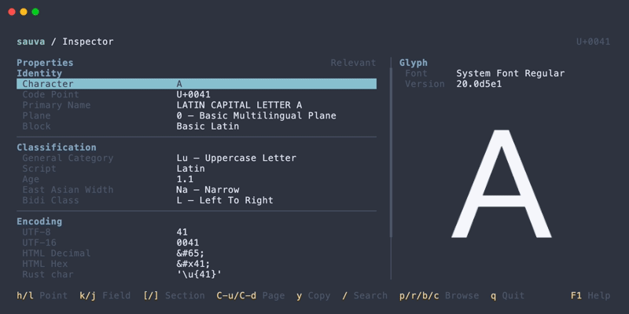
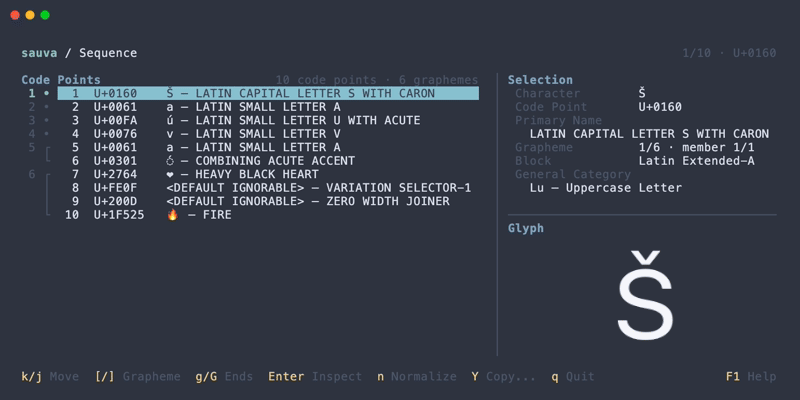

# Sauva

[](https://crates.io/crates/sauva)
[](https://ratatui.rs)

Terminal Unicode Explorer 🪄



## About

Sauva is a terminal application for searching and browsing Unicode code points. It shows Unicode properties and a glyph preview in a responsive TUI.

- Inspect Unicode properties, encodings, and glyph previews.
- Search, browse, and bookmark code points.
- Analyze strings by code point and grapheme cluster, and compare Unicode normalization forms.
- Customize colors, fonts, and keybindings.

The bundled data is based on Unicode 17.0.0. See [Features](https://lusingander.github.io/sauva/features/) for details and screenshots.

## Documentation

For detailed usage, configuration, and terminal support, see the [full documentation](https://lusingander.github.io/sauva/).

## Installation

If you're using Cargo:

```sh
cargo install --locked sauva
```

Homebrew and pre-built binaries are also available. See [Installation](https://lusingander.github.io/sauva/getting-started/installation.html) for all options.

## Usage

### Inspect a code point

Run `sauva` without arguments, or specify a character or code point:

```sh
sauva
sauva あ
sauva U+2192
```

### Analyze text in Sequence mode

Pass a string to inspect its code points and grapheme clusters:

```sh
sauva 'Á👩‍💻'
```



Use `--text -` to read literal UTF-8 text from stdin:

```sh
printf 'Á👩‍💻' | sauva --text -
```

See [Basic Usage](https://lusingander.github.io/sauva/getting-started/basic-usage.html) for more examples.

For all command line options, run `sauva --help` or see [Command Line Options](https://lusingander.github.io/sauva/getting-started/command-line-options.html).

### Keybindings

| Key | Description |
| --- | --- |
| Arrow keys | Move the selection or inspect adjacent code points |
| <kbd>Enter</kbd> | Open the selected item or inspect a code point |
| <kbd>Backspace</kbd> | Go back in Browse or return from the Inspector to its source list |
| <kbd>Esc</kbd> | Close the current view; quit from the Inspector or Sequence |
| <kbd>/</kbd> | Open Search from the Inspector |
| <kbd>F1</kbd> | Open or close contextual help |
| <kbd>Ctrl-C</kbd> | Quit from any view |

See [Keybindings](https://lusingander.github.io/sauva/keybindings/) for all controls.

### Config

Customize colors, fonts, and keybindings in the [configuration file](https://lusingander.github.io/sauva/configurations/).

## Compatibility

Sauva supports macOS and Linux. Glyph previews are supported in kitty and Ghostty. Text features remain available without glyph images. See [Compatibility](https://lusingander.github.io/sauva/getting-started/compatibility.html) for details.

Glyph previews use fonts installed on your system. To extend symbol coverage, you can optionally install Noto Sans Symbols 2. See [Fonts](https://lusingander.github.io/sauva/getting-started/compatibility.html#fonts) for more suggestions.

## Contributing

Please review [CONTRIBUTING.md](CONTRIBUTING.md) before opening an issue or pull request.

## License

Sauva is distributed under the [MIT License](LICENSE).

The generated Unicode data is derived from the Unicode Character Database. See [THIRD_PARTY_NOTICES](THIRD_PARTY_NOTICES.md) and the [Unicode License v3](UNICODE-LICENSE.txt) for details.
